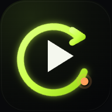
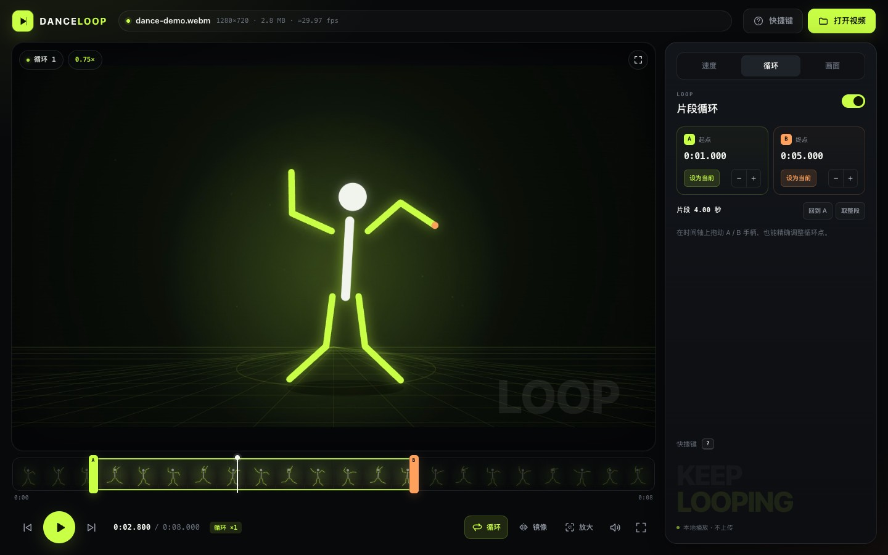
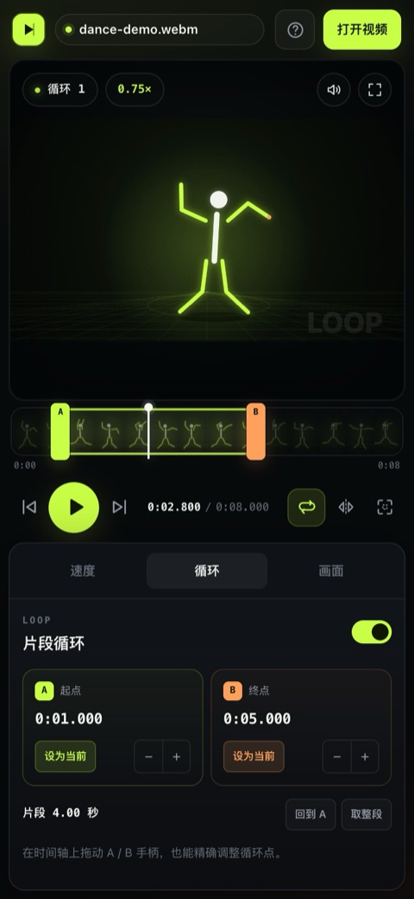
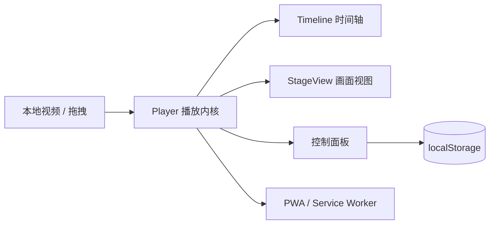

<div align="center">
  
  <h1>Dance Loop</h1>
  <p><strong>街舞扒舞练习器</strong> · 本地视频 · A-B 循环 · 变速 · 逐帧 · 局部放大</p>
  <p>
    
    
    
    
  </p>
  <p>
    <a href="#功能">功能</a> ·
    <a href="#快速开始">快速开始</a> ·
    <a href="#使用方法">使用方法</a> ·
    <a href="#快捷键">快捷键</a> ·
    <a href="#手机使用">手机使用</a> ·
    <a href="#部署">部署</a> ·
    <a href="#创建-github-项目">创建 GitHub 项目</a> ·
    <a href="#技术栈与项目结构">技术栈</a> ·
    <a href="#faq">FAQ</a>
  </p>
</div>

<p align="center">
  
</p>

<p align="center">
  <sub>截图中的舞蹈画面为自动生成的演示素材，不含真实视频；界面与当前版本一致。</sub>
</p>

**Dance Loop** 是一个为街舞扒舞设计的本地视频练习器。打开手机或电脑里的 MP4，截取一段动作，循环慢放，逐帧对照，再框选局部放大——视频始终留在本机，不上传。

- 🎬 **为扒舞而生**：A-B 循环、0.3× 慢放、逐帧、局部放大，一个界面完成
- 📱 **手机也能用**：小米 14 / Android Chrome 上触屏操作，支持添加到主屏幕
- 🔒 **完全本地**：通过 `URL.createObjectURL(file)` 读取视频，无后端、无账号、无上传
- ⚡ **轻量**：Vite + TypeScript + 原生 DOM/CSS，无前端框架运行时

---

## 功能

### 播放与练习

- **A-B 片段循环**：播放到 B 点自动跳回 A 点；可在时间轴上拖动 A / B 手柄，或点「设为当前」精确设点。
- **循环计数**：舞台左上角显示 `循环 ×N`，方便知道已经练了几遍。
- **变速播放**：0.3× / 0.5× / 0.75× / 1× 预设；也可自定义 **0.1×–2.0×**。
- **保持音调**：慢放时人声/音乐音调不变（可开关）。
- **逐帧查看**：上一帧 / 下一帧；自动估算 24 / 25 / 30 / 60 fps。
- **时间轴缩略图**：自动生成整段视频的缩略图，快速找到要练的段落。
- **拖动预览**：拖动时间轴时暂停并预览画面，松手后恢复原来的播放状态。
- **屏幕常亮**：播放时自动申请 Screen Wake Lock，暂停时释放（支持的浏览器）。

### 画面

- **显示大小**：适应窗口 / 铺满窗口 / 自定义 **25%–150%**。
- **局部放大**：点「框选放大」，在视频上拖一个框，自动放大到该区域。
- **手势缩放**：双指捏合、鼠标滚轮、缩放滑杆；最高 **8×**。
- **拖动平移**：放大后可直接拖动画面，找到想看的细节。
- **快速复位**：点舞台左上角的「复位」或按 `0` 回到 1×。
- **镜像画面**：左右翻转，学舞时特别方便。
- **全屏**：手机浏览器上隐藏地址栏和界面干扰。

### 设备与 PWA

- **响应式布局**：Mac / 平板 / 手机共用一套界面；手机竖屏是视频 + 底部面板，横屏自动切左右布局。
- **触屏手势**：双指缩放、单指平移、轻点播放/暂停。
- **PWA**：部署到 HTTPS 后，Android Chrome 可「添加到主屏幕」，像 App 一样全屏运行。
- **离线打开**：Service Worker 缓存应用本身（视频仍是你本地选择的文件）。
- **设置记忆**：速度、镜像、音调、画面大小等保存在浏览器 `localStorage`。

> **没有**包含：人物抠像去背景、姿态识别、AI 超分。这些在 [Roadmap](#roadmap) 里，当前版本专注于把基础扒舞体验做顺。

---

## 快速开始

### 环境要求

- **Node.js 20.19+**（推荐 22+）
- Chrome / Edge / Safari 新版
- 任意 H.264 MP4 视频

> Windows / Linux 也可以用，只是 `start.command` 是 macOS 专用脚本；用下面的命令行方式即可。

### macOS 一键启动

双击项目根目录的 **`start.command`**。

它会自动检查依赖、安装、构建，并在浏览器打开：

```text
http://localhost:4173
```

关闭弹出的终端窗口即可停止服务。

> 第一次双击如果提示没有权限，在终端执行一次：
> ```bash
> chmod +x start.command
> ```

### 命令行启动

```bash
cd dance-loop
npm install
npm run dev
```

打开终端里显示的 `http://localhost:5173/`。

| 命令 | 作用 |
| --- | --- |
| `npm run dev` | 开发模式，修改代码后自动刷新 |
| `npm run typecheck` | 只做 TypeScript 类型检查 |
| `npm run build` | 构建生产版本到 `dist/` |
| `npm run preview` | 本地预览生产版本（4173 端口） |

---

## 使用方法

### 1. 打开视频

点右上角 **「打开视频」**，或者把 MP4 直接拖进窗口。

支持 MP4 / MOV / WebM；建议使用 **H.264 编码的 MP4**，兼容性最好。

### 2. 截取要练的片段

1. 拖动时间轴到舞蹈开始的位置；
2. 在「循环」页签点 **「A 设为当前」**；
3. 拖到结束位置，点 **「B 设为当前」**；
4. 也可以直接拖动时间轴上的 **A / B 彩色手柄**微调。

设置好后，循环会自动开启。

### 3. 循环播放

- 点底部工具栏的 **「循环」** 或按 `L` 开关 A-B 循环；
- 播放到 B 点会自动回到 A 点；
- 舞台左上角会显示当前循环次数；
- 点「回到 A」可以立刻从 A 点开始。

### 4. 变速

- 点舞台左上角的当前速度（例如 `1.00×`），或打开「速度」页签；
- 点 **0.3× / 0.5× / 0.75× / 1×** 快速切换；
- 也可以在「自定义速度」输入 `0.65`、`0.8` 等值；
- 慢放时默认保持音调，可在「速度」页签关闭。

### 5. 逐帧看动作

- 点播放键两侧的 **上一帧 / 下一帧**；
- 或按 `←` / `→`；
- 按 `Shift` + `←` / `→` 前后跳 1 秒。

逐帧会暂停播放；帧率根据视频自动估算。

### 6. 局部放大

1. 点底部工具栏的 **「放大」**，或「画面」页签里的 **「框选放大」**；
2. 在视频画面上拖动一个矩形；
3. 松开后自动放大到该区域；
4. 放大后单指/鼠标拖动平移；双指捏合或滚轮继续缩放；
5. 点舞台左上角的「复位」或按 `0` 回到 1×。

> 也支持直接双指捏合 / 鼠标滚轮缩放，以及「画面」页签里的缩放滑杆。

### 7. 画面大小、镜像、全屏

- **画面大小**：「画面」页签 →「显示大小」→ 适应 / 铺满 / 自定义；
- **镜像**：底部工具栏「镜像」或按 `V`；
- **全屏**：按 `F` 或点全屏按钮。

---

## 快捷键

| 按键 | 功能 |
| --- | --- |
| `空格` | 播放 / 暂停 |
| `←` / `→` | 上一帧 / 下一帧 |
| `Shift` + `←` / `→` | 后退 / 前进 1 秒 |
| `A` / `B` | 把当前时间设为 A / B 点 |
| `L` | 开启 / 关闭 A-B 循环 |
| `Z` | 框选局部放大 |
| `V` | 镜像画面 |
| `M` | 静音 / 取消静音 |
| `F` | 全屏 |
| `0` | 复位缩放 |
| `1` / `2` / `3` / `4` | 0.3× / 0.5× / 0.75× / 1× |
| `[` / `]` | 速度 − / + 0.05× |
| `?` | 打开快捷键帮助 |

在输入框中输入时快捷键不会触发。手机端可直接使用界面按钮和手势。

---

## 手机使用

### 方式一：同一 Wi-Fi 直接打开（最快）

1. Mac 上运行 `npm run dev` 或双击 `start.command`；
2. 终端会显示一个 **Network** 地址，例如：
   ```text
   http://192.168.1.40:4173
   ```
3. 小米 14 连接同一个 Wi-Fi，在 Chrome 地址栏输入这个地址；
4. 点「打开视频」，选择手机里的舞蹈视频。

> 此时功能都能用，但 HTTP 局域网地址**不能安装 PWA / 不能离线**（浏览器安全限制）。想装到桌面，用下面的 HTTPS 部署方式。

### 方式二：安装到主屏幕（推荐日常使用）

1. 把应用部署到 HTTPS（[Netlify](#netlify-drop) 或 [GitHub Pages](#github-pages-自动部署)）；
2. 小米 14 用 Chrome 打开部署后的网址；
3. 右上角菜单 → **添加到主屏幕 / 安装应用**；
4. 之后从桌面图标打开，就是全屏、无地址栏的练习器。

> iPhone / iPad：用 Safari 打开部署后的网址 → 分享 → 添加到主屏幕。

<p align="center">
  
</p>

> 手机端同样支持双指缩放、单指平移、轻点播放/暂停；播放时会尽量保持屏幕常亮。

---

## 部署

### Netlify Drop

最简单的方式，不需要账号也可以先试：

1. 构建：
   ```bash
   npm run build
   ```
2. 打开 [Netlify Drop](https://app.netlify.com/drop)；
3. 把整个 **`dist` 文件夹**拖进去；
4. 得到一个 `https://xxxx.netlify.app` 地址；
5. 手机 Chrome 打开 → 添加到主屏幕。

登录 Netlify 后可以保留站点并绑定自定义域名。

### GitHub Pages 自动部署

仓库里已经包含 [`.github/workflows/deploy.yml`](.github/workflows/deploy.yml)：

1. 把代码推到 GitHub 的 `main` 分支；
2. 进入仓库 **Settings → Pages**；
3. **Build and deployment → Source** 选择 **GitHub Actions**；
4. 等待 Actions 里的 `Deploy to GitHub Pages` 完成；
5. 访问：
   ```text
   https://<你的用户名>.github.io/dance-loop/
   ```
6. 手机 Chrome 打开这个 HTTPS 地址 → 添加到主屏幕。

> 如果第一次 Actions 在开启 Pages 之前就失败了，开启 Pages 后进入 Actions → 选择失败的运行 → **Re-run all jobs** 即可。

> 构建使用相对路径，所以部署在 `/<repo>/` 子路径下也能正常加载和安装 PWA。

### Vercel

- 导入 GitHub 仓库；
- Framework Preset 选 **Vite**；
- Build Command: `npm run build`；
- Output Directory: `dist`。

---

## 创建 GitHub 项目

### 如果当前目录还不是 Git 仓库

```bash
cd dance-loop
git init -b main
git add .
git commit -m "feat: initial Dance Loop"
```

> 本仓库的初始版本已经完成过首次提交；如果你拿到的目录里已经有 `.git`，可以跳过上面的初始化，直接从下一步开始。

### 在 GitHub 新建空仓库

打开 [github.com/new](https://github.com/new)：

- Repository name：建议 `dance-loop`
- 选择 **Public** 或 **Private**
- **不要**勾选 Add a README / .gitignore / license（项目里已有）
- 点击 Create repository

> 想使用免费的 GitHub Pages，仓库通常需要是 **Public**；Private 仓库的 Pages 取决于 GitHub 套餐。也可以改用 Netlify 部署私有仓库。

### 关联远端并推送

```bash
git remote add origin https://github.com/<你的用户名>/dance-loop.git
git push -u origin main
```

如果已经安装 [GitHub CLI](https://cli.github.com/)，也可以一步完成：

```bash
gh repo create dance-loop --public --source=. --remote=origin --push
```

推送完成后，按上面的 [GitHub Pages](#github-pages-自动部署) 开启自动部署，就能得到手机可安装的 HTTPS 地址。

> 如果 HTTPS 推送时提示需要密码，GitHub 现在要求使用 **Personal Access Token**（或在 GitHub Desktop 里登录），不能直接用账号密码。

### 使用 GitHub Desktop（可选，更简单）

1. 打开 GitHub Desktop → **File → Add Local Repository**；
2. 选择 `dance-loop` 文件夹（不要选上层的 `study_movie`）；
3. 点 **Publish repository**；
4. 选择 Public / Private（免费 GitHub Pages 建议 Public）；
5. Publish。

> ⚠️ **仓库根目录是 `dance-loop/`**。不要在上层 `study_movie/` 里执行 `git add .`，否则可能把旁边的个人视频一起提交。`node_modules/` 和 `dist/` 已被 `.gitignore` 忽略，仓库只包含源码、截图和配置，体积很小。

---

## 技术栈与项目结构

**Vite 8 + TypeScript + 原生 DOM/CSS + vite-plugin-pwa**，没有使用 React/Vue 等框架，视频解码、缩放、镜像都交给浏览器原生能力。

```text
dance-loop/
├── index.html                  # 页面结构、SVG 图标、快捷键面板
├── src/
│   ├── main.ts                 # UI 绑定、事件、设置持久化、PWA 注册
│   ├── player.ts               # A-B 循环、变速、逐帧、帧率估算
│   ├── viewport.ts             # 画面尺寸、缩放、平移、双指捏合、框选放大
│   ├── timeline.ts             # 时间轴、A/B 手柄、拖动预览
│   ├── thumbnails.ts           # 隐藏 video 生成缩略图
│   ├── utils.ts                # 时间格式化、设置存储
│   └── style.css               # 响应式样式 / 动效
├── public/                     # SVG / PWA 图标
├── docs/                       # README 截图
├── .github/workflows/deploy.yml
├── start.command               # macOS 一键启动
├── vite.config.ts              # Vite + PWA 配置
└── README.md
```



---

## 浏览器与视频格式

- 推荐 **H.264 编码的 MP4**；Chrome / Edge / Safari 新版均可。
- HEVC / MOV 能否播放取决于系统解码器；如果打不开，先转成 H.264。
- 4K 视频也能放，但高倍局部放大会变糊，建议练习用 1080p。
- 如果视频无法播放，可以用 ffmpeg 转换：

```bash
ffmpeg -i input.mov -c:v libx264 -preset fast -crf 20 -c:a aac -b:a 192k output.mp4
```

也可以使用 HandBrake（图形界面）转成「H.264 MP4」。

---

## 已知限制

- **循环采用瞬时跳回 A 点**：普通 1080p 本地视频基本无感；超大 4K 文件在跳回时可能有一帧左右的停顿。
- **帧率是自动估算的**：可变帧率（VFR）视频的「±1 帧」可能不完全精确。
- **没有 AI 抠像 / 超分**：当前版本只做基础扒舞；见下方 Roadmap。
- **PWA 安装需要 HTTPS / localhost**：局域网 HTTP 可以正常使用，但无法安装/离线。
- **浏览器解码能力**：建议 H.264 MP4；HEVC 兼容性取决于设备和浏览器。

---

## Roadmap

- [x] A-B 循环、变速、逐帧、画面尺寸、局部放大、镜像
- [x] 响应式手机布局、触屏手势、PWA、屏幕常亮
- [ ] 人物抠像 / 背景虚化（MediaPipe ImageSegmenter）
- [ ] 姿态识别 + 自动跟随人物放大（PoseLandmarker）
- [ ] WebGL 实时锐化 / 画质增强
- [ ] Real-ESRGAN 离线超分导出
- [ ] Tauri 2 打包 macOS `.app` / Android `.apk`

---

## FAQ

**手机上打不开？**
确认手机和 Mac 在同一 Wi-Fi；使用终端显示的 Network 地址，不要用 `localhost`；检查 Mac 防火墙是否拦截了 4173/5173 端口。

**Chrome 没有出现「安装应用」？**
PWA 安装需要 HTTPS 或 localhost。局域网 HTTP 地址只能当普通网页用；部署到 Netlify / GitHub Pages 后再试，必要时刷新一次页面。

**视频打不开 / 黑屏？**
大概率是编码问题。优先试 H.264 MP4；MOV/HEVC 在部分 Chrome 上不支持。也可以先用 ffmpeg 或 HandBrake 转码。

**循环点有轻微停顿？**
这是 seek 式循环的代价。1080p 一般不明显；4K 可以先用 HandBrake 压到 1080p。

**没有声音？**
检查底部/HUD 的静音按钮；手机浏览器需要先点一下播放才允许出声。

**视频会上传吗？**
不会。视频只在本机浏览器中通过 Object URL 读取，PWA 缓存也不会缓存你的视频文件。

---

## 隐私

- 视频通过 `URL.createObjectURL(file)` 在本地读取，不发送到网络。
- 不包含任何后端、统计脚本、账号系统或广告。
- 设置只保存在浏览器 `localStorage`。
- Service Worker 只缓存应用本身的 HTML/CSS/JS/图标。

---

## 贡献

欢迎提 Issue 和 PR。开发前建议先开 Issue 说明方向。

```bash
npm install
npm run dev
npm run build
```

提交前请确保 `npm run build` 通过。

---

## License

[MIT](LICENSE)

<p align="center"><sub>KEEP LOOPING · 视频不出本机</sub></p>
